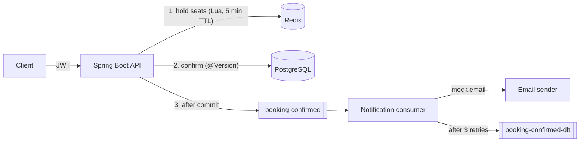

# Ticket Booking Backend

A seat-booking REST API that prevents double booking under concurrent requests.

**Stack:** Java 17, Spring Boot 4, PostgreSQL, Redis, Kafka, Spring Security (JWT), Docker Compose, JUnit 5, Testcontainers

## Architecture



## Design decisions

| Problem | Solution |
|---|---|
| Two users pick the same seat | Redis hold with a TTL. A Lua script makes multi-seat holds all-or-nothing, and repeating a hold cannot extend it. |
| The Redis hold is lost or expires mid-request | JPA `@Version` on `Seat`, so only one transaction can book it. |
| Client retries a confirm request | `Idempotency-Key`, unique per user in the database. Concurrent retries get the same booking; reusing a key for different seats returns 422. |
| Expired hold released by its old owner | Release is compare-and-delete, so it never removes another user's hold. |
| Slow or failing email | Kafka consumer, 3 retries one second apart, then a dead-letter topic. Duplicate deliveries are skipped. |
| Acting as another user | Identity comes from the JWT, never the request body. Only ADMIN can create shows. |

## Test results

10 integration tests run against real PostgreSQL, Redis and Kafka containers. Concurrency tests use 100 threads released together:

| Scenario | Result |
|---|---|
| 100 users hold one seat | 1 success, 99 conflicts |
| 100 users confirm one seat with the Redis check bypassed | 1 booking, 99 rejected |
| 100 concurrent retries with the same idempotency key | 1 booking, returned to all 100 |

```bash
./gradlew test    # needs Docker
```

## Run

Everything in Docker:

```bash
./gradlew bootJar
docker compose --profile app up --build
```

Or only the infrastructure, then run `TicketbookingApplication` from the IDE:

```bash
docker compose up -d
```

API: http://localhost:18085, Swagger UI: http://localhost:18085/swagger-ui.html

Ports are non-default to avoid clashes: PostgreSQL 5433, Redis 6380, Kafka 9094. All times are UTC. The credentials in this repository are local development defaults; override them with `JWT_SECRET`, `ADMIN_EMAIL`, `ADMIN_PASSWORD`, `DB_USER` and `DB_PASSWORD`.

## API

| Method | Path | Access |
|---|---|---|
| POST | `/api/auth/register`, `/api/auth/login` | Public |
| GET | `/api/shows`, `/api/shows/{id}/seats` | Public |
| POST | `/api/shows` | ADMIN |
| POST | `/api/shows/{id}/hold` | User |
| POST | `/api/bookings` (with `Idempotency-Key` header) | User |
| GET | `/api/bookings` | User (own bookings) |

Request bodies:

```text
register / login : {"email":"a@test.com","password":"password123"}
create show      : {"name":"Concert","venue":"Arena","startTime":"2030-01-01T19:00:00","totalSeats":10}
hold             : {"seatIds":[1,2]}
confirm          : {"showId":1,"seatIds":[1,2]}
```

Local admin login: `admin@ticketbooking.local` / `admin12345`

## Known limitations

- The Kafka event is published after commit, so a crash in between loses the notification (not the booking). A transactional outbox would close this gap.
- Email delivery is mocked and at-least-once. There is no payment step.
- The schema uses `ddl-auto: update`; production should use Flyway.
