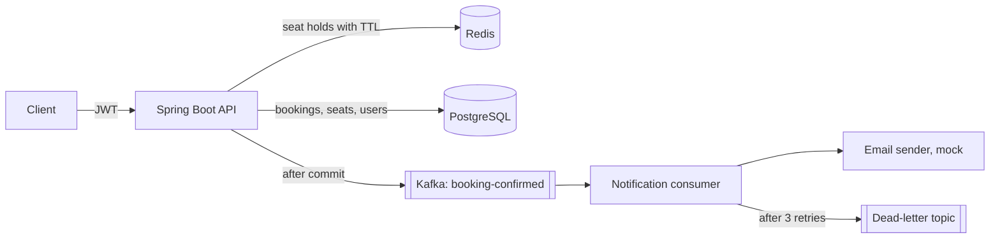
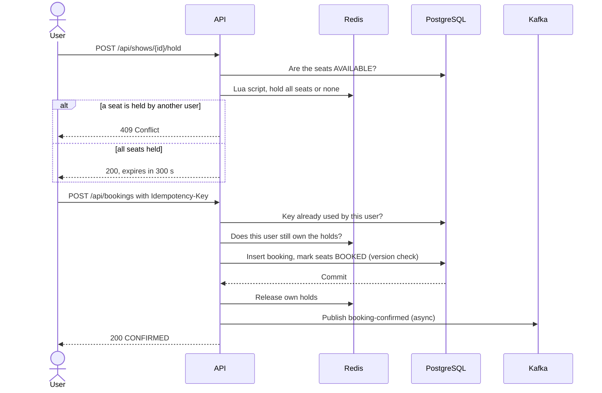
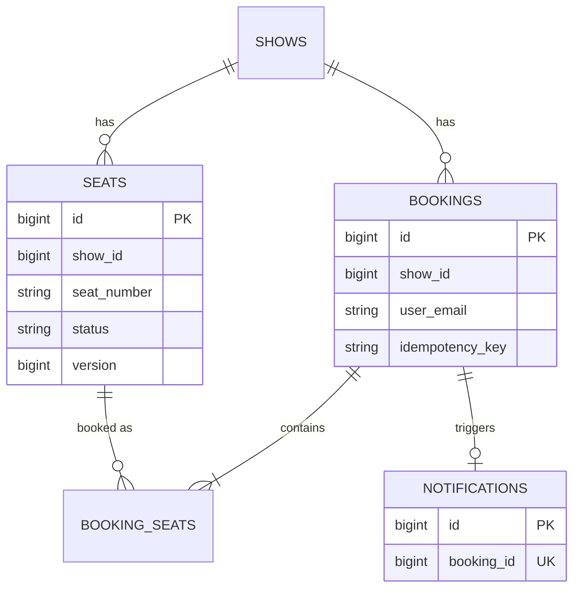

# System Design

## Goal

Let many users compete for the same seats while guaranteeing that a seat is never sold twice, and that a retried request never creates a second booking.

## Components

## Booking flow

## Data model

Relations are stored as ids. `(user_email, idempotency_key)` and `(show_id, seat_number)` are unique.

## Failure handling

| Failure | What happens |
|---|---|
| User abandons checkout | The hold expires after 5 minutes |
| Hold expires before confirming | Confirm returns 409 and the seat stays available |
| Two confirms reach the database together | `@Version` lets one commit, the other gets 409 |
| Client retries a confirm | The same key returns the same booking |
| Key reused for different seats | 422 |
| Email fails | Retried 3 times, then dead-lettered. The booking stands |
| Message delivered twice | The consumer skips bookings already notified |

## Trade-offs

- **Optimistic over pessimistic locking:** Redis removes most contention, so database conflicts are rare and no row locks are held while a user decides.
- **Publish after commit, without an outbox:** simpler, but a crash between commit and publish loses that notification. A transactional outbox would fix it.
- **Single Redis node:** losing it means users must hold their seats again. It cannot cause double booking, because PostgreSQL has the final say.
